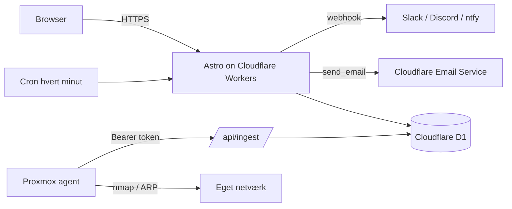

# Sentinel

Et personligt kontrolrum for cybersikkerhed: aktiver, uptime, netværksenheder,
hændelser, sårbarheder, lækage-tjek og krypterede noter samlet på ét
login-beskyttet dashboard.

Bygget med **Astro + Tailwind** og kører serverløst på **Cloudflare Workers**
med **D1** som database. En lille lokal agent scanner dit eget netværk og
uploader fund, så nye enheder, porte og sårbarheder bliver hændelser.

> Dette er et personligt projekt. Agenten må kun bruges mod netværk, du selv
> ejer eller har udtrykkelig tilladelse til at scanne.

## Funktioner

- **Overblik** — KPI-kort, uptime-status, aktive hændelser og aktiver der udløber
- **Aktiver** — domæner, API'er, nøgler og certifikater med udløbsdatoer
- **Uptime** — server-side tjek, latens, historik og automatisk nedetidsalarm
- **Enheder** — netværksenheder med MAC, producent, porte og tjenesteydelser
- **Sårbarheder** — daglig nmap-scan (`--script vuln`) med accepter/løs-flow
- **Hændelser** — logbog med alvor, status, tags, søgning og filtre
- **Lækage-tjek** — adgangskode via k-anonymity og e-mail via HIBP
- **Noter** — AES-GCM-krypteret i browseren; serveren ser kun ciphertext
- **Notifikationer** — webhook og/eller e-mail via Cloudflare Email Service

## Arkitektur



- Astro SSR + Tailwind v4
- Cloudflare Workers + D1 (SQLite), migrationer i `migrations/`
- Cron Trigger tjekker uptime og rydder op
- Lokal agent på Proxmox/Linux: hurtigt scan hvert 15. minut og daglig
  sårbarhedsscan

## Sikkerhed

- PBKDF2-HMAC-SHA256 (100.000 iterationer, Cloudflares loft) med salt
- Sessioner gemmes kun som SHA-256-hash, 12 timers idle-timeout, "log ud alle"
- Rate limiting pr. konto/IP og pr. IP, gemt i D1
- CSRF-beskyttelse via SameSite + Origin-tjek
- CSP, HSTS, `X-Frame-Options`, `nosniff`, `no-referrer`, Permissions-Policy
- Agent-ingest validerer input, er scopet pr. agent og har body-/alertlofter
- Notifikationer er begrænset og kan sendes uden IP/MAC (minimal tilstand)
- Kun én bruger kan oprettes (`ALLOW_BOOTSTRAP=false` i produktion)

Se [`docs/SECURITY-REVIEW.md`](docs/SECURITY-REVIEW.md) for den fulde review og
de bevidste afvejninger.

## Kom i gang lokalt

```sh
npm install
cp wrangler.example.jsonc wrangler.jsonc
npm run cf-typegen
```

Rediger `wrangler.jsonc`:

- `database_id` → kan stå som placeholder lokalt
- `send_email` → dine egne adresser, hvis du vil teste e-mail

```sh
npm run cf-migrate:local
cp .dev.vars.example .dev.vars   # slår ALLOW_BOOTSTRAP til lokalt
npm run dev                      # http://localhost:4321
```

Første besøg opretter din konto. Herefter kan du slå `ALLOW_BOOTSTRAP` fra.

## Deploy til Cloudflare

```sh
npx wrangler login
npx wrangler d1 create sentinel
# indsæt database_id i wrangler.jsonc
npm run cf-migrate:remote
npm run deploy
```

Første konto oprettes ved midlertidigt at sætte `ALLOW_BOOTSTRAP` til `"true"`,
deploye, oprette kontoen og sætte den tilbage til `"false"`.

Fuld guide: [`docs/DEPLOY.md`](docs/DEPLOY.md).

## Agenten

Agenten kører på en maskine i dit eget netværk, fx en Proxmox-host:

```sh
scp ~/sentinel/agent/{sentinel-agent.mjs,nmap-xml.mjs,install-proxmox.sh} root@<host>:/root/
```

Se [`docs/AGENT.md`](docs/AGENT.md) for opsætning, systemd-timere og
sikkerhedsnoter.

## Struktur

```text
agent/                # lokal scanner (Proxmox/Linux)
migrations/           # D1-skema
src/
├── components/       # StatusBadge, StatCard, Panel, EmptyState
├── layouts/          # Shell.astro
├── pages/            # dashboard, assets, uptime, devices, vulnerabilities, ...
│   └── api/          # form-POSTs, ingest og JSON-endpoints
├── server/           # auth, store, repo, notify, email, ratelimit
├── worker.ts         # fetch + scheduled
├── middleware.ts     # sessioner, CSRF, sikkerhedsheaders
└── styles/           # design-tokens
wrangler.example.jsonc
docs/                 # DESIGN, DEPLOY, AGENT, SECURITY-REVIEW
```

## Screenshots

Tilføj gerne skærmbilleder i `docs/screenshots/` og indsæt dem her, så
projektet er nemt at vurdere uden login.

## Licens

MIT — se [`LICENSE`](LICENSE).
